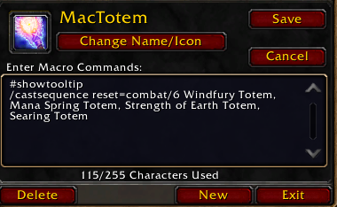
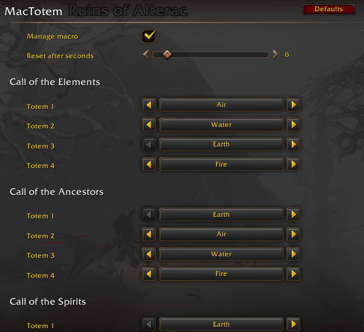

# MacTotem

WoW Forever addon for shamans that keeps one macro casting the totems of the active totem
bar page in sequence.

## Features

- **Totem macro** - the general (account) macro `MacTotem` holds a `/castsequence` of
  the totems set on the active page of the Blizzard totem bar (Call of the Elements,
  Ancestors, or Spirits).
- **Cast order per set** - for each totem set (Call of the Elements, Ancestors, Spirits)
  choose which element (Earth, Fire, Water, Air) is cast first, second, third, and
  fourth, or None to skip a totem (None always moves to the end); default is Earth, Fire,
  Water, Air.
- **Never deleted** - MacTotem only creates and rewrites the macro, never deletes it;
  each shaman with MacTotem rewrites it for their own totem bar on login.
- **Always in sync** - the macro updates when you assign or remove a totem or switch the
  page; changes made in combat apply right after combat.
- **Reset timer** - the sequence restarts after combat and, optionally, after 1-60
  seconds without a cast.
- **Shamans only** - other classes get no macro.
- **Remembered** - settings are saved per account; default is off.
- **Settings page** - all options in the game menu under Options > AddOns, also opened
  from the addon compartment menu.
- **Chat commands** - every option can also be changed by slash command.

## Screenshots





## Install

1. Download `MacTotem-vX.Y.Z.zip` from the [releases](https://github.com/tf4482/MacTotem/releases).
2. Unzip it into `World of Warcraft/_forever_/Interface/AddOns/`.
3. Restart the game or type `/reload`.
4. Type `/mt on`, then drag `MacTotem` from the macro window (`/macro`, general tab)
   onto an action bar.

## Usage

```text
/mt                              show the state and the totems of the active page
/mt on                           manage the macro
/mt off                          stop managing the macro (the macro stays as it is)
/mt reset <s>                    restart the sequence after s seconds, 0 = only after combat
/mt order <set> <a> [b] [c] [d]  cast order of set 1-3: earth, fire, water, air; left out = none
/mt config                       open the settings page
/mt help                         list all commands
```

`/mactotem` works as well (in case another addon already uses `/mt`).

## Examples

- Totem bar page 1 holds Strength of Earth, Searing, Healing Stream, and Windfury: the
  macro becomes `/castsequence reset=combat Strength of Earth Totem, Searing Totem, ...`;
  press it four times to drop all four.
- `/mt order 2 fire earth air water`: with Call of the Ancestors active, the macro drops
  the fire totem first and the water totem last; the settings page shows the same order
  under the Call of the Ancestors header.
- `/mt order 1 earth air`: Call of the Elements drops only the earth and air totems; fire
  and water show None at positions 3 and 4.
- `/mt reset 8` gives `reset=combat/8`: pausing 8 seconds starts again at the first
  totem.
- Switch the totem bar to Call of the Spirits: the macro follows that page at once, or
  right after combat.

## Develop

Check the code with [Luacheck](https://github.com/lunarmodules/luacheck) before each commit
(CI runs it on every push):

```text
luacheck .
```

## License

All rights reserved, see [LICENSE](LICENSE).
